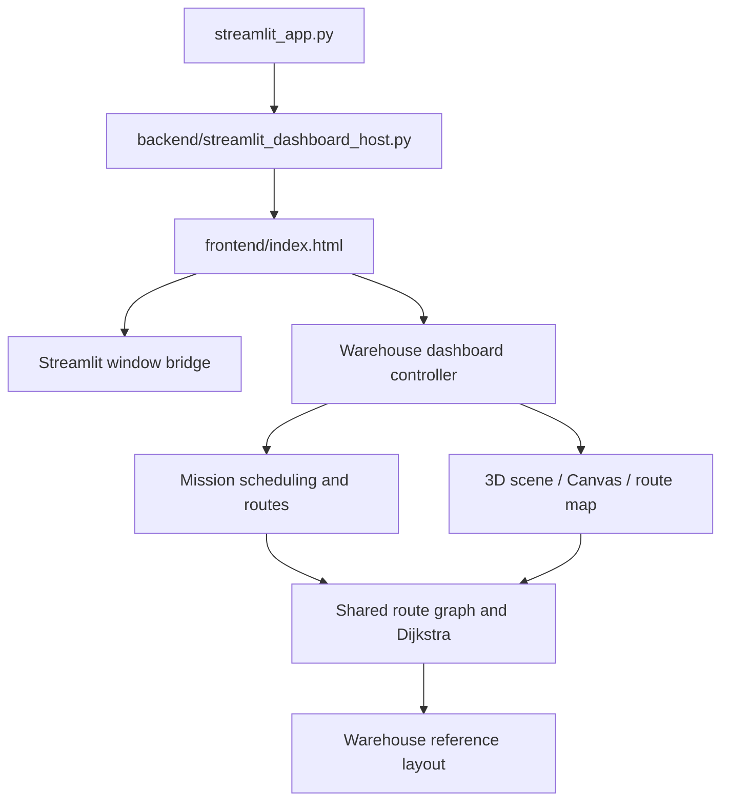

# Repository structure and project flow

## Folder boundaries

| Folder | Contains | Excludes |
| --- | --- | --- |
| `frontend/src/app/` | Dashboard controller, early theme selection and interface motion | Python host and physical motor control |
| `frontend/src/routing/` | Graph validation, Dijkstra, actual search trace and interactive map | Approved mission mutation by the preview |
| `frontend/src/simulation/` | Virtual mission feasibility, reservations, motion and charging-aware scheduling | Physical device commands |
| `frontend/src/telemetry/` | Browser subscription panel and received measurement validation | Durable Python storage |
| `frontend/src/twin/` | State observer, calibration, recording/replay, paired policy comparisons and lab UI | Broker secrets in worker snapshots |
| `frontend/src/workers/` | Isolated stock/battery forecasts and dispatch policy studies | Direct dispatch authority |
| `frontend/src/warehouse/` | Shared reference racks, aisles, stops and route graph | Claimed survey of the physical testbed |
| `frontend/src/visualization/` | Three.js scene, industrial geometry and Canvas fallback | Independent versions of routing or mission rules |
| `frontend/src/hosting/` | Streamlit readiness/height protocol and workspace scroll lifecycle | Robot readings sent to Python |
| `frontend/styles/`, `assets/`, `vendor/` | Styles, icon/fonts and licensed browser dependencies | Backend service source |
| `frontend/downloads/` | Generated kits and reading copies from canonical sources | Hand-maintained duplicate implementations |
| `backend/` | Streamlit host and optional Python edge recorder/adapter | Browser rendering code |
| `firmware/` | Arduino sketch and non-secret example settings | Configured connection headers |
| `tests/` | Frontend, backend and integration verification | Production runtime dependencies |
| `docs/`, `tools/` | Guides, evidence and reproducible maintenance commands | Application state or broker credentials |

## Dashboard startup

The entrypoint delegates to Python hosting. The frontend loads its bridge and theme before the dashboard controller. Mission rules and visual route previews use the same graph module and reference layout. The Streamlit component key stays stable during ordinary reruns. Embedded scrolling is defined by the bridge and `styles/streamlit_workspace_scroll.css`, leaving the header and navigation visible.

## Measured state and optional archive

The browser's ESP32 panel subscribes to MQTT over secure WebSockets. `robot_measurement_validation.js` checks identity, schema, sequence and age before display. `robot_state_estimation_and_calibration.js` separates measured, estimated and predicted state, manages recordings and gates model fitting. The lab freezes a sanitized scenario for the dispatch experiment worker; the worker returns advisory results without movement authority.

The optional `backend/edge/mqtt_observation_recorder.py` process subscribes independently to archive MQTT observations in SQLite. Its export can be imported into the Twin lab. `labview_inventory_adapter.py` transforms actual perception counts into a validated line for a separate publisher process. It does not start or control the LabVIEW VI.

## File names and generated files

Project source filenames use descriptive snake_case names. Entry conventions such as `index.html`, `README.md`, `requirements.txt`, `package.json` and `__init__.py` retain their standard names. Vendor filenames and license notices retain upstream identities. Arduino's folder and sketch names match.

Canonical source lives in its owning folder. `tools/build_dashboard_downloads.py` creates two ZIP files, three document reading copies and the ownership notice in `frontend/downloads/`. An integration check verifies every archive member against its source and refuses stale downloads. Backend and firmware source are never copied into the frontend module directories.

The [path migration manifest](verification/repository_path_migration.json) accounts for all 104 previously tracked files. [Historical evidence](verification/previous_release/) retains previous release logs and original source fingerprints; their old paths describe that historical release. Current fingerprints are recorded separately.

For literal source filenames and responsibilities, read the [frontend guide](../frontend/README.md), [backend guide](../backend/README.md) and [firmware guide](../firmware/README.md).
