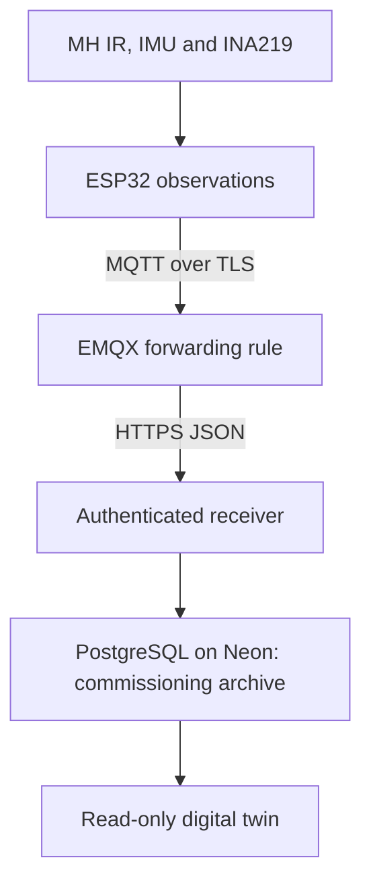
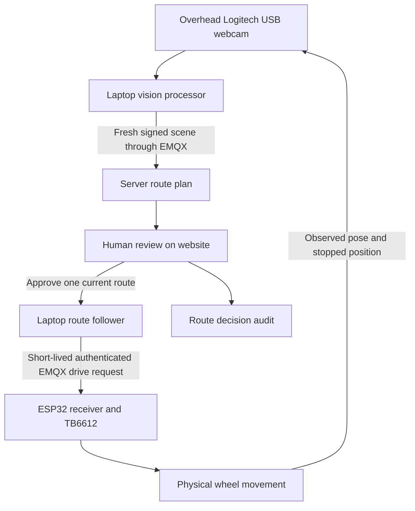
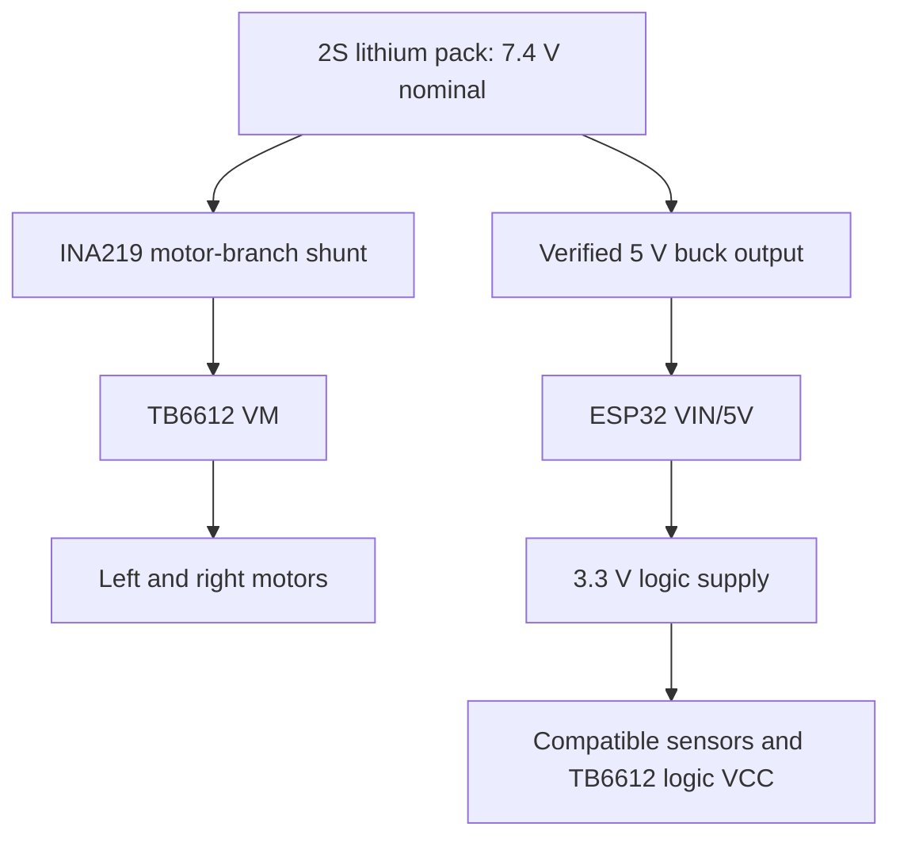

# AMR-01 system architecture

Open **System architecture** in the digital twin. Four interactive journeys explain sensor data, vision and movement, calibrated models and human review, and power. Every component identifies its input, output, execution location and prerequisites. The page only reads public server status; exploring it does not open a camera, change a sensor source, publish messages or authorize movement.

## Current status and evidence

Physical commissioning observations are stored through EMQX HTTP forwarding into PostgreSQL hosted on Neon. PostgreSQL is the database engine; Neon is its cloud hosting service. The calibrated model path and physical vision-control path are implemented separately; their hardware commissioning remains required. Recorded dimensions and passing software tests do not establish physical accuracy or authorize driving. The architecture page reports fresh physical archive availability, valid model outputs and guarded route readiness independently. It withholds positive status when the source is a demo, evidence is old or server updates stop.

## Sensor data: installed hardware to archive

The installed single-channel MH IR sensors produce unsigned pulses. ESP32 reports measured pulses, IMU and motor-branch electrical observations on `robot/amr01/commissioning`. Robot/boot/sequence identify a packet. The HTTP receiver authenticates before reading the body, validates the schema and rejects invalid packets. Identical retries are deduplicated; conflicting evidence for an existing identity is rejected.

`amr_commissioning_samples` preserves the received observations. Original broker receive time, rather than later database storage time, determines freshness. Missing device packets cannot be reconstructed. The website displays current observations and keeps old records available in Database. Geometry supports unsigned RPM/rim-speed magnitudes; direction, signed odometry and battery charge do not follow from unsigned counts alone.

See [physical recording](physical_sensor_recording.md), [installed hardware](mh_ir_hardware_commissioning.md) and [receiver](../backend_streamlit_and_telemetry/commissioning_webhook/handler.mjs).

## Vision and physical movement: one Logitech webcam

The physical camera is the overhead Logitech USB webcam connected to the Windows laptop. Our laptop program reads this same device. The Windows Camera application and a camera mounted on the AMR are not required. Website Practice preview is a separate placement aid; it does not supply a trusted physical scene or drive commands.

The laptop vision processor validates camera intrinsics, floor references, marker mounting, image continuity and the obstacle envelope. The server owns the proposed route, destination, evidence identity and review expiry. The operator supplies a reason and chooses Approve & run, Reject or Hold. Browser geometry and local rehearsal decisions never become execution authority.

The route follower checks matching approval, current scene/hardware evidence and the approved path. The ESP32 drive receiver enforces authenticated bounded requests and a short lease. Stop, lost operator presence, stale evidence, changed obstacles or path departure end the movement grant. Arrival needs distinct fresh camera observations and stopped-state evidence; an MQTT publish or an acknowledgement alone is not arrival. Local protection and a physical cutoff remain necessary.

The laptop must stay powered, connected to the webcam and network. See [complete commissioning and route workflow](human_approved_physical_route_execution.md). Camera pose applies to the measured 425 × 630 mm floor, separately from the illustrative 3D warehouse.

## Calibrated models and recommendation review

The full model worker uses the separate `robot/amr01/state` signed-sensor contract. It requires direction-sensing feedback, measured wheel geometry, stationary gyro bias and battery calibration. The current unsigned commissioning records are not silently converted into that contract.

| Stage | Responsibility | Evidence and limits |
| --- | --- | --- |
| Admission | Identity, boot/sequence, finite-value, retained-message and continuity checks | Unknown intervals stay unknown |
| Python models | Wheel displacement, local differential-drive pose, corrected gyro, power/energy, charge and sustained gyro–encoder residual | Calibration and model assumptions apply per output |
| Persistence | Samples, states, quality events, calibration fingerprints and atomic checkpoint | One trial writer; recovery preserves committed state and records uncertainty |
| Recommendations | Explain motion disagreement and reserve conditions; constant-input position/runtime forecasts | Valid current evidence required; residual is not a fault diagnosis |
| Human review | Capture exact recommendation context, authorize eligible decisions and audit outcomes | Request, controller acknowledgement and three fresh confirming sensor observations are separate stages |

Connect AMR is an optional session-bound recorder for the calibrated path. The independent HTTP commissioning archive does not require that button. Do not run competing writers for the same model trial. The general sensor intervention channel and camera-guided route channel have separate contracts and commissioning requirements.

See [sensor model setup](single_amr_sensor_twin_setup.md), [database pipeline](postgresql_sensor_pipeline.md), [equations and assumptions](slide_to_code_mapping.md) and [human recommendation review](website_human_review_and_action.md).

## Power: parallel branches from the 2S pack

All modules share common ground. INA219 observes the motor branch; the buck/ESP32 branch bypasses that shunt. Motor-branch current therefore does not establish whole-pack consumption. Usable capacity, initial charge and current calibration remain requirements for quantitative battery forecasts. Motor voltage/stall-current, driver limits and board power arrangements require physical verification.

## Recorded operator setup

| Item | Supplied value |
| --- | --- |
| Full body | 180 × 150 × 150 mm |
| Wheels | 65 mm diameter, 100 mm centre spacing, 20 counted pulses per turn |
| IMU axes and stationary bias | X forward, Y left, Z up; Z bias +0.02°/s = +0.000349066 rad/s |
| Robot marker | ArUco 4×4/50 ID 0, 40 mm black edge, 150 mm above floor |
| Marker position | 100 mm forward of wheel-axle midpoint, 0 mm sideways; printed-frame alignment still requires verification |
| Overhead webcam and working floor | Logitech USB, reported 920 mm height; 425 × 630 mm floor |
| Battery | Reported 2,200 mAh pack and 100% trial starting charge; measured usable capacity/current charge not established by that report |

## Separate simulation and operating boundaries

Practice, the illustrative warehouse floor, virtual stock and task events remain separate from physical telemetry and control. There is no surveyed transform automatically placing sensor odometry into the 3D reference warehouse. Physical inventory events, absolute heading, diagnostic fault classification and whole-pack runtime are not implied by the architecture diagram. Readiness is established from the appropriate physical evidence, not from a static drawing or a successful software test.
