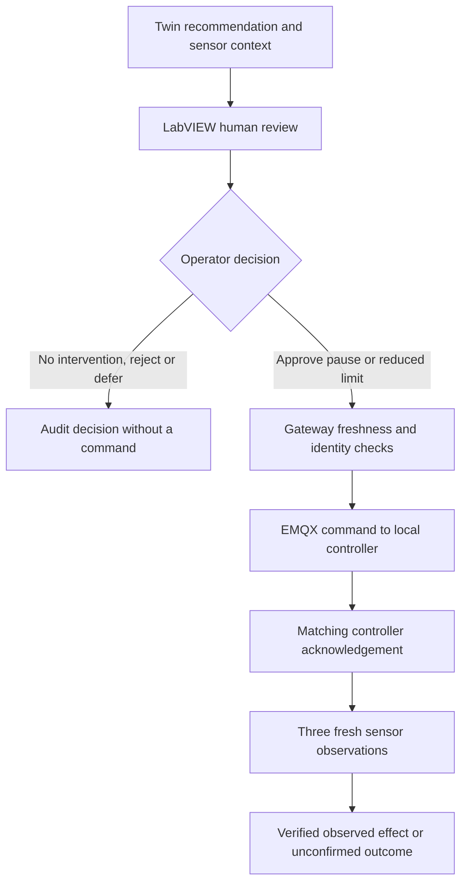

# Human review and action through LabVIEW

The twin supplies evidence and recommendations. LabVIEW is the physical operator's decision point. One protected gateway validates and records that decision. The website monitors physical reviews and offers a separate generated rehearsal.



The gateway never issues start, resume, steering or navigation commands. No intervention sends no motor command. A reduced-limit request must halve the controller's **current local output limit**, may never increase it or start a stopped motor, and cannot override a local limit. A pause is a locally controlled stop, not a cloud emergency-stop mechanism. Local motor protection, watchdog and independent stopping remain necessary.

## What is implemented

- **Sensor models → Human review & action:** generated rehearsal with a captured recommendation, choice of intervention, required reason, approve/reject/defer, separate simulated acknowledgement and sensor-observation steps, and an outcome trail. The rehearsal allows 60 seconds to walk through the response stages; the physical response deadline is five seconds. Rehearsal records live only in that viewer's session and never reach the physical database or MQTT.
- **LabVIEW API:** authenticated loopback HTTP on port 8766 with exact request fields and bounded bodies. The Python Node adapter and native HTTP Client VIs use the same endpoints. LabVIEW's native `.vi` front panel must be wired and tested on the control workstation; this repository does not claim to contain a compiled VI.
- **Shared PostgreSQL audit:** one `amr_operator_reviews` row captures immutable source fields, recommendation context, operator decision, command, correlated acknowledgement and ordered lifecycle events. Operator identity here is a client-supplied audit alias, not independent proof of a person's identity. This is an application audit, not a tamper-proof ledger.
- **Command gateway:** explicit opt-in, MQTT/TLS, exact command/ack topics, fresh calibrated evidence, one active review, serialized decisions, idempotency, deadline handling, and no replay after restart. Transport acceptance does not prove execution. Its process lease is distinct from the sensor ingester's lease.
- **Outcome checks:** a matching **applied** acknowledgement and three new, fresh same-boot samples after the controller's application time are required. Duplicate samples do not advance verification. Pauses need wheel speed estimates at or below 0.01 m/s and an explicit paused, stopped or standby controller state. Reduced-limit requests need estimates at or below half the pre-dispatch maximum absolute wheel speed plus 0.01 m/s. This confirms a sensor-observed bound, not causality or ground truth.

The physical receiver is **not commissioned**. The current MH IR firmware does not subscribe to commands or publish intervention acknowledgements. Keep command delivery disabled until the local receiver below is implemented and physically tested. No broker command permissions have been enabled by this change.

## Operator and command states

| State | Meaning |
| --- | --- |
| Awaiting human review | Recommendation and source sample captured; review expires in 30 seconds |
| Reviewed / rejected / deferred | Human decision recorded; no command sent |
| Approved · delivery unavailable | Human approval recorded, gateway disabled; enabling it later does not replay this approval |
| Awaiting controller acknowledgement | Request sent once; MQTT transport success is not execution |
| Checking new sensor readings | Matching controller reports applied; physical effect is not yet verified |
| Observed effect verified | Three qualifying post-application readings observed |
| Review expired | Human review/context expired before dispatch |
| Outcome unconfirmed | Delivery deadline, transport failure or gateway restart; do not assume stopped or retry automatically |

## Provision the audit table

Use the same trial database as the sensor ingester. Test the additive change on an isolated database branch before applying it to production.

```sh
python -m project_maintenance_scripts.provision_operator_review_database
```

The command reads private `AMR_DATABASE_ADMIN_URL`. It creates only the intervention table/index. It does not alter sensor packets, calibrations, checkpoints or historical model states. Use a dedicated restricted gateway login, created privately. Give it SELECT on existing sensor tables/views, and SELECT/INSERT/UPDATE on `amr_operator_reviews`; no DELETE, schema CREATE or ownership. The app reader needs SELECT only on the new table. Gateway credentials and the LabVIEW key never enter the browser.

```sql
GRANT SELECT ON TABLE public.amr_operator_reviews TO amr_reader;
-- Replace amr_reviewer with the privately provisioned gateway login:
GRANT SELECT, INSERT, UPDATE ON TABLE public.amr_operator_reviews TO amr_reviewer;
```

## Run on the LabVIEW workstation

Install the repository's Python requirements and configure these private environment values:

| Setting | Meaning |
| --- | --- |
| `AMR_HITL_DATABASE_URL` | Direct restricted gateway connection to the shared trial database; session advisory locks require a direct connection |
| `AMR_LABVIEW_API_KEY` | Random secret with at least 32 characters; shared only with the local LabVIEW client |
| `AMR_MEASURED_CALIBRATION_CONFIRMED` | `true` only after measurement |
| `AMR_CALIBRATION_JSON` | The same measured `amr01` calibration used by the sensor ingester |
| `AMR_HITL_COMMANDS_ENABLED` | Leave unset or false for review-only commissioning |
| `AMR_HITL_CONTROLLER_READY` | Set true only after implementing and physically testing the receiver |
| `AMR_MQTT_HOST`, `AMR_HITL_MQTT_USERNAME`, `AMR_HITL_MQTT_PASSWORD` | Dedicated command-gateway credentials; required only when delivery is enabled |
| `AMR_EMQX_CA_FILE` | Optional trusted CA file; certificate verification stays enabled |

```sh
python -m backend_streamlit_and_telemetry.predictive_twin.labview_gateway
```

The API is bound to `127.0.0.1`, has no browser approval path and is not exposed as a public endpoint. LabVIEW and gateway run on the same workstation. Keep the sensor ingester running independently. A physical recommendation requires fresh, continuous, calibrated encoder/gyro/battery samples; commissioning-only MH IR messages are insufficient.

## LabVIEW wiring

Use HTTP Client **Open Handle → Add Header → GET/POST → Close Handle**, JSON strings, and error/status indicators. Add `Authorization: Bearer <private key>` and `Content-Type: application/json`. NI's [POST VI](https://www.ni.com/docs/en-US/bundle/labview-api-ref/page/vi-lib/httpclient/post-vi.html) and [JSON content-type instructions](https://knowledge.ni.com/KnowledgeArticleDetails?id=kA00Z0000019X3tSAE&l=en-US) document those controls. Alternatively load `labview_review_client.py` into the LabVIEW Python Node.

1. GET `/context` to show current recommendation, raw evidence and readiness. Never infer readiness just from the API responding.
2. Generate one 32-character hexadecimal review ID once and retain it across retries. POST `/reviews` with `{"review_id":"<saved id>"}`. The server captures the evidence itself; clients cannot supply or replace it.
3. Show **No intervention / Halve current speed limit / Controlled pause**, a reason input and separate **Approve / Reject / Decide later** buttons.
4. POST `/reviews/<id>/decision` with `{"decision":"approve","action":"pause","operator":"operator01","reason":"Inspect sustained motion disagreement"}`. Other actions are `no_action` and `reduce_speed`; other decisions are `reject` and `defer`.
5. Poll GET `/reviews/<id>`. Show sent, acknowledgement and observed verification separately. On an uncertain outcome, inspect the local controller. Do not automatically submit a replacement command.

Do not place API keys in URLs, project source or screenshots. Decisions and free-text reasons are visible only through the protected API/audit; the public website strips the operator alias and reason from its physical monitor.

## Local receiver contract to commission

- Gateway publishes non-retained JSON to `robot/amr01/commands`; receiver publishes non-retained acknowledgements to `robot/amr01/command_ack`. Each account needs only its permitted direction on those exact topics. Existing telemetry-only accounts remain unchanged.
- Command fields: `command_id`, `robot_id`, `target_boot_id`, `source_seq`, `source_sample_time_s`, `action`, `speed_limit_percent`, `issued_at_ms`, `expires_at_ms`.
- Before any actuation, validate identity, own boot, exact action and bounds, unique command ID, issue/expiry (2 seconds) against a synchronized clock, and the device monotonic source time. Reject retained, expired, replayed or wrong-boot requests. Persist/reconcile replay state for the boot. Never infer authorization from a command title or recommendation text.
- Acknowledgement fields: `command_id`, `robot_id`, `boot_id`, `action`, `source_seq`, `status`, `applied_sample_time_s`. Status is `accepted`, `applied` or `rejected`. For `applied`, use the device monotonic application time within the approved source window. An accepted acknowledgement alone cannot verify an outcome.
- Apply only the local allowed limit or controlled pause. A command cannot start motion, increase output, clear a watchdog or resume a paused robot. Local physical controls retain authority. Continue the existing measured sensor stream for outcome verification.
- Test motor timing, reconnect/reboot, stale/retained/duplicate requests, wrong boot, loss of acknowledgement, local rejection and emergency stopping with the actual receiver before enabling `AMR_HITL_CONTROLLER_READY`.
