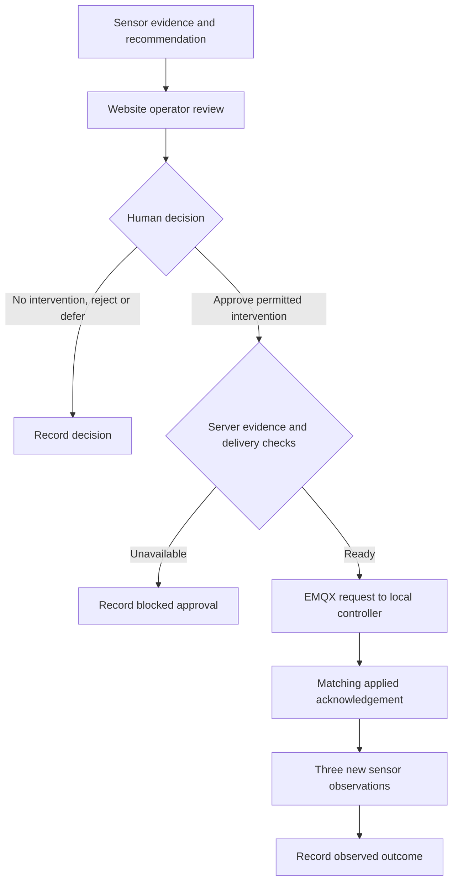

# Website human review and action

The website is the operator's decision point. Sensor models shows recommendations and **Review & decide** in one flow. The Python server captures current evidence, authenticates the operator session and records the decision in the shared PostgreSQL audit. No desktop application, local HTTP service or additional workstation is required.

## Live observation review

AMR-01's installed commissioning stream supplies live recommendations from battery voltage/current/power, both encoder channels, gyro/acceleration, requested/reported motor output and connection quality. The dashboard checks current sensor validity and recent same-boot history, then ranks findings as stop-and-check, check or monitor. See the [complete checks and response catalog](live_sensor_recommendations.md) for evidence requirements and screening settings.

Nine responses cover monitoring, stop-and-inspect, reviewing lower power, charging, motor-power inspection, wheel feedback, gyro calibration, connection recovery and general sensor inspection. Enter the existing operator alias/code, capture fresh evidence, choose a response and record a reason. Selecting a recommendation in Direct Wi-Fi drive opens the review and suggests its response; it never approves it automatically.

**Open Drive control** opens the installed ESP32 controller inside the dashboard at the saved IP `10.55.54.112`, with the saved response's instructions. Apply the response using those local controls or complete the physical task. Recording a decision sends no motor command, and opening the controller is not an acknowledgement. The installed receiver has no dashboard approval API. EMQX continues to carry sensor data; local control goes directly over Wi-Fi.

The review records the choice, then collects three distinct fresh subsequent readings. The result shows battery input before/after and the latest guidance. It does not claim that the chosen physical task occurred. **Follow-up readings recorded** remains distinct from a verified command effect. For a longer task, capture a new review after fresh readings resume.

Observation review uses the existing `[amr_connection] enabled`, direct `writer_url`, `access_code` and `amr_operator_reviews` permissions. It needs no firmware upload or database migration and cannot publish or queue a motor command, even when another publisher is enabled. Practice and the calibrated intervention workflow remain separate.

Only packets up to five seconds old can support an observation review. The browser also expires live recommendations if updates stop. Each approval captures the boot, saved settings, screening policy and recommendation categories/priorities/actions; numeric jitter alone does not invalidate the same guidance. Changed context requires a new review. Follow-up requires increasing sequence and device time after the decision; duplicate and stale packets do not count. Boot/settings/policy changes leave the outcome unconfirmed. The 30-second follow-up deadline and restart recovery prevent old decisions from resuming.

The following command-delivery sections describe the separate fully calibrated intervention contract; they are not requirements for observation reviews.

## Panel layout

The default view uses three plain stages: **Get ready → Make a decision → Check the result**. Missing calibration has a short preparation checklist, expandable measurement guidance and a direct commissioning-guide link. **Check AMR connection** opens the existing connection screen. **Try a practice review** explicitly selects demo data; it never unlocks physical control.

The recommendation card freezes the captured guidance for a pending review. The decision card explains each response, requires a reason and preserves your draft during updates. **Keep operation unchanged** records a review without a motor request. When command delivery is unavailable, approval is labelled **Record approval only** and cannot queue a later command. An expired review must be captured again. Source changes clear the decision draft and reset its response to no change.

Results show **Request**, **AMR response** and the count of qualifying **Sensor check** readings separately. Demo response buttons say exactly which stage they simulate. Authentication, service availability, ownership, fresh evidence and server-side verification remain mandatory. Technical categories and the decision history are available in a collapsed disclosure.

## Operator workflow

1. Select **Demo data** to rehearse with generated evidence. Capture a recommendation, choose an action, enter a reason and approve, reject or defer. Simulated acknowledgement and simulated follow-up readings are separate steps. This session never writes to physical tables or contacts a device.
2. For physical review, select **Stored sensor data**, enter your operator alias and the existing private operator code, then select **Unlock operator review**. The code is cleared from the input after submission. It is never included in display snapshots or stored in browser storage.
3. Capture a recommendation to review. The server assigns the review ID and captures fresh sensor context itself. Only the authenticated session that captured this review can decide it. Another viewer can monitor the public outcome but cannot adopt that review.
4. Select **No intervention**, **Halve the current controller speed limit** or **Request controlled pause**, record a reason, and approve, reject or defer. Review expires after 30 seconds. Changed recommendations, boot/calibration changes, missing continuity or samples older than two seconds prevent delivery.
5. Read the status and **Decision & outcome trail**. A sent request is transport acceptance. A matching applied acknowledgement is the controller's report. Three qualifying new observations establish the displayed observed effect. These are distinct stages.
6. Select **Lock operator session** when finished. Rotating the private code invalidates existing review authorizations. The shared code protects access; the self-reported alias is an audit label, not independent identity verification. Public snapshots omit aliases and free-text reasons.

## Physical readiness and private settings

The supplied MH IR sketch publishes commissioning measurements and accepts local serial commands. It does not subscribe to intervention commands or publish acknowledgements. Physical delivery remains disabled. Full review evidence also requires measured calibration and continuous signed-encoder, gyro and battery inputs. Single-channel unsigned counts cannot provide those missing measurements.

The website reuses the existing private configuration. Keep credentials out of Git, browser code, screenshots and downloadable public kits.

| Setting                                                 | Purpose                                                                                                                         |
| ------------------------------------------------------- | ------------------------------------------------------------------------------------------------------------------------------- |
| `[amr_connection] enabled`, `writer_url`, `access_code` | Existing operator-protected connection; writer uses the direct PostgreSQL host because the review service holds a session lease |
| `[mqtt] host`, `username`, `password`                   | Existing telemetry subscriber configuration; never reused to publish commands                                                   |
| `[commissioning] measured_calibration_confirmed`        | True only after physical measurement                                                                                            |
| `[calibration.amr01]`                                   | Same measured calibration as the sensor ingester                                                                                |
| `[intervention] enabled`, `controller_ready`            | Both must explicitly be true after physical receiver validation; absent means disabled                                          |
| `[intervention] mqtt_username`, `mqtt_password`         | Separate server-only command transport account, needed only for commissioned delivery                                           |

No new broker command permissions are created by the website change. The server publishes only through a commissioned transport whose exact acknowledgement subscription has been confirmed. It sends each permitted request once, without retained delivery or automatic replay. No command may start motion, increase a local limit, steer, resume or override local motor protection. A pause is a controlled local stop, not a cloud emergency stop.

## Database and service ownership

The existing `amr_operator_reviews` table/index stores captured evidence, decision, command, acknowledgement and lifecycle events. The dashboard reader keeps SELECT only. The restricted server writer needs SELECT, INSERT and UPDATE on this table, with no DELETE, schema CREATE or ownership. The narrowly scoped grant is maintained in [the migration SQL](../project_maintenance_scripts/website_review_writer_grant.sql). Test it on an isolated Neon branch before production approval. Runtime never creates or alters schema.

One shared server resource owns review recovery and monitoring across browser sessions. A PostgreSQL process lease is distinct from the telemetry writer lease; transaction advisory locks serialize decisions. Losing that lease prevents further delivery. On restart, unfinished approvals expire or become unconfirmed and are never replayed. Demo data uses a separate session-local SQLite store.

## Status and outcome interpretation

| Status                              | Meaning                                                                                     |
| ----------------------------------- | ------------------------------------------------------------------------------------------- |
| Awaiting human review               | Captured recommendation, pending for at most 30 seconds                                     |
| Reviewed / rejected / deferred      | Decision recorded without a command                                                         |
| Approved · delivery unavailable     | Approval recorded, delivery disabled; enabling later cannot replay it                       |
| Awaiting controller acknowledgement | Request sent once; execution unconfirmed                                                    |
| Checking new sensor readings        | Matching controller reports applied; observed effect still pending                          |
| Observed effect verified            | Three distinct fresh same-boot observations meet the requested bound                        |
| Review expired                      | Context or review expired before delivery                                                   |
| Outcome unconfirmed                 | Delivery deadline, transport error, ownership loss or restart; inspect the local controller |

The physical response deadline is five seconds. Demo rehearsal allows 60 seconds to inspect the stages. Pauses require wheel-speed estimates at or below 0.01 m/s and an explicit paused, stopped or standby state. Reduced-limit verification requires estimates at or below half the pre-dispatch maximum absolute wheel speed plus 0.01 m/s. Duplicate or pre-application samples do not advance verification. These observations do not establish causal diagnosis or independent ground truth.

## Local receiver contract to commission

- Gateway publishes non-retained JSON to `robot/amr01/commands`; receiver publishes non-retained acknowledgements to `robot/amr01/command_ack`. Each account needs only its permitted direction on those exact topics. Existing telemetry-only accounts remain unchanged.
- Command fields: `command_id`, `robot_id`, `target_boot_id`, `source_seq`, `source_sample_time_s`, `action`, `speed_limit_percent`, `issued_at_ms`, `expires_at_ms`.
- Before any actuation, validate identity, own boot, exact action and bounds, unique command ID, issue/expiry (2 seconds) against a synchronized clock, and the device monotonic source time. Reject retained, expired, replayed or wrong-boot requests. Persist/reconcile replay state for the boot. Never infer authorization from a command title or recommendation text.
- Acknowledgement fields: `command_id`, `robot_id`, `boot_id`, `action`, `source_seq`, `status`, `applied_sample_time_s`. Status is `accepted`, `applied` or `rejected`. For `applied`, use the device monotonic application time within the approved source window. An accepted acknowledgement alone cannot verify an outcome.
- Apply only the local allowed limit or controlled pause. A command cannot start motion, increase output, clear a watchdog or resume a paused robot. Local physical controls retain authority. Continue the existing measured sensor stream for outcome verification.
- Test motor timing, reconnect/reboot, stale/retained/duplicate requests, wrong boot, loss of acknowledgement, local rejection and emergency stopping with the actual receiver before enabling the private controller readiness setting.
